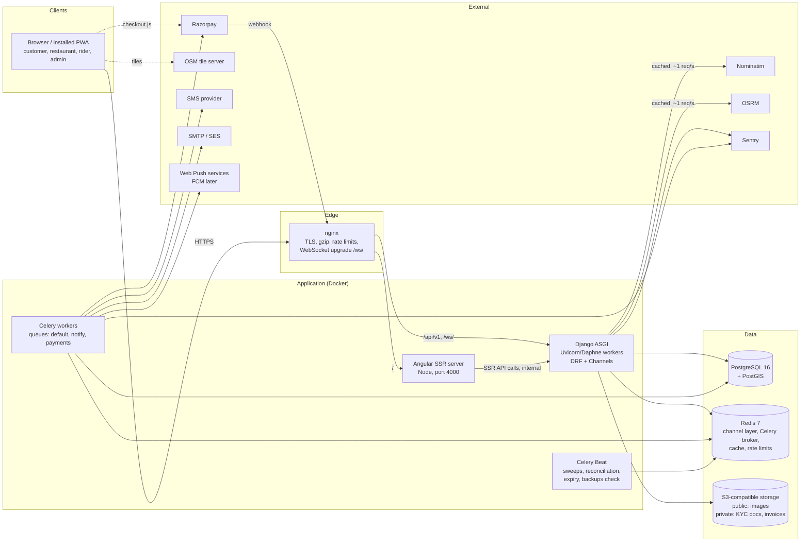
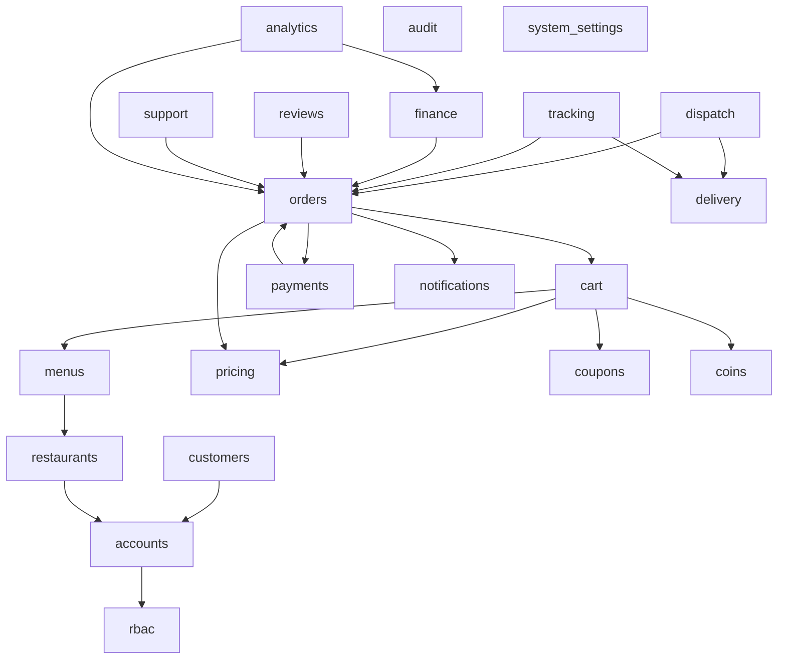
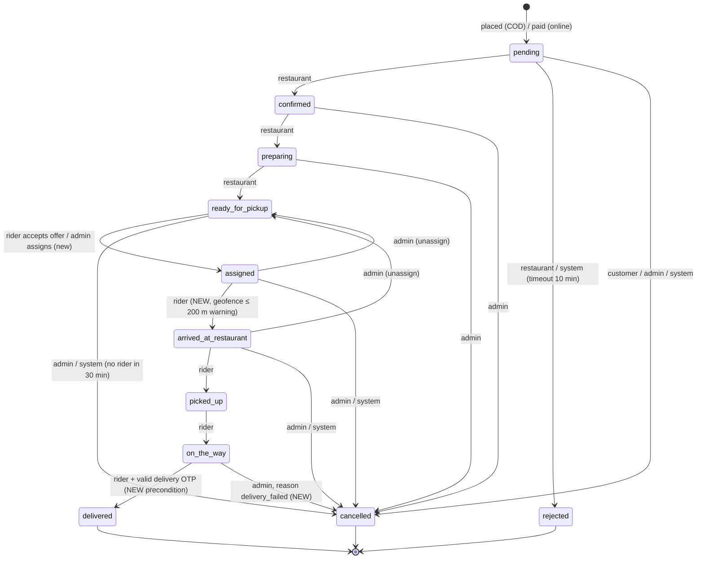
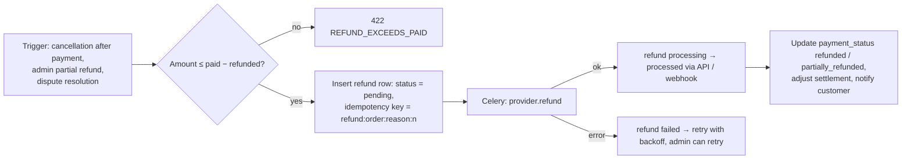
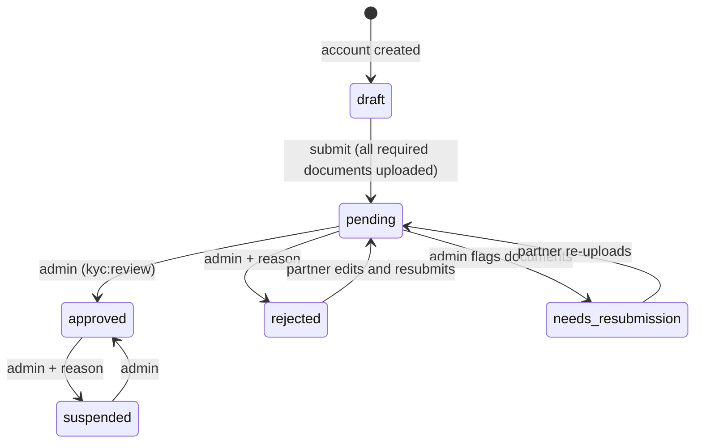
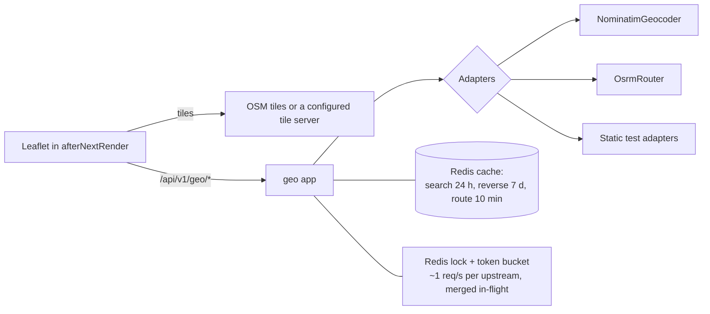

# 2. Architecture and workflows

Phase 1 deliverables B (system architecture), C (workflows), M (DRF strategy) and O (maps architecture).

## 2.1 System architecture



**Process responsibilities**

| Process | Runs | Scales by |
|---|---|---|
| `api` (ASGI) | HTTP views, WebSocket consumers, webhook intake | More instances behind nginx. The Redis channel layer fans events out across them. |
| `worker` | Notifications (email, SMS, push), payment calls (refunds, reconciliation), PDF invoices, geocoding prefetch | More workers per queue |
| `beat` | Schedules only (exactly one instance) | Not scaled |
| `web` | Angular SSR | More instances |

**Why ASGI for all HTTP?** One server type, one deployment unit. Synchronous DRF views run in Django's thread pool under ASGI. This is acceptable at launch scale, and the alternative (separate WSGI for HTTP) can be split out later without code changes.

## 2.2 Module boundaries



Rules:
- **Only `orders.workflow` changes `Order.status`.** Other modules call `workflow.transition(...)`.
- **Only `coins.wallet` writes wallet and ledger rows.**
- **Only `payments.service` changes payment state.**
- Cross-module side effects after a status change go through an in-process **domain event dispatcher** (`orders.events.order_transitioned`). It is called inside `transaction.on_commit`, so nothing fires for a rolled-back change. Handlers that call external services enqueue Celery tasks.
- Django signals are used only for model-local concerns (e.g. cache invalidation), never for business flows. Signals hide control flow and run inside the transaction.

## 2.3 Order lifecycle (proposed)

The current table (MASTER_PROMPT §A2) is extended with one new status, `arrived_at_restaurant`. The delivery OTP becomes a **precondition** on `on_the_way → delivered` rather than a separate status. Delivery failure is handled as a reasoned cancellation, so no new terminal state is needed.



**Independent status axes** (as today, made explicit):

| Axis | Values | Owner |
|---|---|---|
| `orders.status` | above | `orders.workflow` |
| `orders.payment_status` | pending, paid, failed, refunded, partially_refunded (new), cancelled | `payments.service` |
| `delivery_assignments.status` | offered, accepted, declined, expired, cancelled, completed | `dispatch` |

**Delivery OTP rules**
- 4 random digits, generated when the order reaches `picked_up`. Stored as an HMAC hash, never in plain text. The customer reads it via `GET /orders/{id}` (customer only).
- Up to 5 attempts. Further attempts return 423 `OTP_LOCKED`, and the rider must contact support. An admin with `orders:manage` can mark the order delivered with a reason (audited).
- The setting `delivery.otpRequired` (default on) allows disabling it per city later.

## 2.4 Workflow diagrams

### Checkout and payment

```mermaid
sequenceDiagram
  autonumber
  actor C as Customer
  participant UI as Angular
  participant API as Django API
  participant DB as PostgreSQL
  participant RZ as Razorpay
  participant Q as Celery

  C->>UI: Place order
  UI->>API: POST /orders (Idempotency-Key, expectedTotalPaise, paymentMethod)
  API->>DB: BEGIN; lock cart; re-quote; reserve coupon and coins; insert order (+ snapshot)
  alt total differs from expectedTotalPaise
    API-->>UI: 409 PRICE_CHANGED (new quote)
  end
  alt COD
    API->>DB: submitted_at = now; COMMIT
    API-->>UI: 201 order
    API->>Q: on_commit → notify restaurant, emit order:updated
  else Online
    API->>DB: submitted_at = NULL; COMMIT
    API-->>UI: 201 order (awaiting payment)
    UI->>API: POST /payments/orders/{id}/start
    API->>RZ: create order (amount from DB)
    API-->>UI: gateway order id, key id
    UI->>RZ: checkout.js
    RZ-->>UI: payment id + signature
    UI->>API: POST /payments/orders/{id}/confirm
    API->>API: verify HMAC signature and amount
    API->>DB: mark paid; submitted_at = now (idempotent)
    RZ--)API: webhook payment.captured (raw body HMAC)
    API->>DB: insert webhook event (unique id) → no-op if already paid
  end
  Note over Q: Beat: unpaid > 15 min → cancel, release coupon and coins, restore cart
```

### Dispatch

```mermaid
sequenceDiagram
  autonumber
  participant WF as orders.workflow
  participant D as dispatch
  participant DB as PostgreSQL
  participant R as Rider
  participant B as Beat (every 15 s)

  WF->>D: on_commit(order → ready_for_pickup)
  D->>DB: nearest eligible rider (PostGIS KNN, ≤ 10 km, fresh ≤ 15 min, online, approved, KYC verified, no offer/active order, not in declined set)
  D->>DB: UPDATE delivery_partner SET current_offer = order WHERE current_offer IS NULL AND active_order IS NULL (CAS)
  D->>DB: insert delivery_assignment(status = offered, expires_at = now + 90 s)
  D-->>R: ws offer (user:<id>)
  alt rider accepts within 90 s
    R->>D: POST /delivery/offers/{id}/accept
    D->>DB: CAS assignment offered → accepted; rider.active_order = order
    D->>WF: transition(ready_for_pickup → assigned, actor = delivery)
  else declines or times out
    D->>DB: assignment declined/expired; clear current_offer; add to declined set
    D->>D: offer to the next rider
  end
  B->>D: sweep(now): expire offers, retry waiting orders, cancel after 30 min
```

### Refund (full or partial)



COD orders have no gateway refund. They record a `manual` refund (bank transfer or coins at the customer's choice), which finance completes.

### KYC approval (restaurant and rider)



Each document has its own status (`pending`, `accepted`, `rejected` + reason, `expired`). A Beat task marks documents with an `expires_on` date as expired and notifies the partner 30 days before. An expired licence blocks a rider from going online.

## 2.5 DRF strategy

| Concern | Decision |
|---|---|
| Contract | Keep camelCase. `djangorestframework-camel-case` for the parser and renderer, wrapped by a custom `EnvelopeRenderer` that outputs `{ success, message, data }`. |
| Errors | A custom `EXCEPTION_HANDLER` maps `ApiError(status, message, code, details)`, DRF `ValidationError` (→ 422 `VALIDATION_ERROR`, `error.details: [{ field: 'a.b', message }]` with camelCase dotted paths and `items[1].x` for list items; the body is `{ success: false, message, error: { code, details? } }`), `NotAuthenticated` (401), `PermissionDenied` (403), `Http404` (404) and throttling (429 `RATE_LIMITED`). Anything else becomes a generic 500 with a Sentry event. |
| Validation | Input serializers per action (`OrderCreateInput`), output serializers per audience (`OrderForCustomer`, `OrderForRestaurant`, `OrderForRider`, `OrderForAdmin`), replacing `presentFor*`. Unknown fields are ignored (same as `matchedData`). |
| Views | `APIView`/`GenericAPIView` plus small mixins. **No `ModelViewSet` on business resources**, because the actions are domain operations, not CRUD. ViewSets only for plain admin CRUD (categories, coupons, banners). |
| Services and selectors | `services.py` holds writes (in transactions). `selectors.py` holds reads and query-building. Views call one of each at most. |
| Permissions | `IsRole('customer')`, `HasPermission('orders:manage')` (the `can()` equivalent, reading `rbac.PERMISSIONS`), and object-level `IsOwner` checks in selectors (scope comes from `request.user`, never from ids in the URL). |
| Audit | `@audited(action, resource_type, describe)` decorator on admin views. It writes after a 2xx response in `transaction.on_commit`. |
| Pagination | `page`/`limit` query parameters with `{ items, pagination: { page, limit, total, totalPages } }` (the existing Node shape, `Paginated<T>` in the frontend). |
| Filtering | `django-filter` FilterSets for admin lists. Explicit query serializers for public search. |
| Rate limiting | DRF throttles backed by Redis (auth, OTP, geo search, location updates, push subscribe, promotions), and nginx `limit_req` as an outer guard. |
| Idempotency | `Idempotency-Key` header on order placement, stored in a unique column. Webhook event ids and refund keys are unique. |
| Concurrency | Conditional `UPDATE … WHERE status = %s` (`QuerySet.filter(...).update(...)` returns the affected row count) for status changes and CAS locks. `select_for_update()` for wallet and coupon counters. |
| Docs | drf-spectacular with `extend_schema` on every view. Swagger UI at `/api/docs`, JSON at `/api/docs.json`. |
| Versioning | URL prefix `/api/v1/`. Breaking changes go to `/api/v2/`. |

## 2.6 Real-time (Channels)

| Item | Design |
|---|---|
| Endpoint | `wss://<host>/ws/` (single multiplexed socket) |
| Auth | The first frame is `{"type":"auth","token":"<access>"}` within 5 s, otherwise the server closes with 4401. The token is never put in the URL (it would end up in logs). Expired token → close 4401 → the client refreshes and reconnects (same behaviour as today). |
| Groups | `user.<id>`, `restaurant.<id>`, `admins`, `order.<id>` (joined via `track:join` after a database check; same rules as `sockets/tracking.js`) |
| Frames | `{ "event": "order:updated", "data": {...}, "id": "<uuid>", "at": "<ISO>" }`. Events are unchanged: `order:updated`, `order:location`, `notification:new`, plus `offer:new` (now explicit). Client → server: `track:join`, `track:leave`, `rider:location`, `ping`. |
| Heartbeat | The client sends `ping` every 25 s and the server replies `pong`. Close after 60 s of silence. |
| Duplicates | Each event has an `id`. The client keeps the last 200 ids. Payloads are ids and statuses only; the client re-reads over REST. |
| Rider location | Validated (range, accuracy), throttled to 1 per 3 s per rider in Redis, implausible speed (> 150 km/h) dropped. Writes the latest point to `delivery_partners` and appends to `tracking_points` (sampled every 15 s, kept 30 days). |
| Scale | `channels_redis` channel layer, so any ASGI instance can deliver to any group |

## 2.7 Maps and geo architecture



- **Adapters:** `integrations/geo/base.py` defines `Geocoder` (`search`, `reverse`) and `Router` (`route`). Implementations are chosen from settings (`GEO_GEOCODER=nominatim`, `GEO_ROUTER=osrm`) with URL, user agent and rate limit configurable. Tests swap them with a context manager (`use_router(...)`), mirroring `useProvider`.
- **Merging identical requests across processes:** a Redis `SET NX` lock on the cache key. Waiters poll the cache for up to 5 s. This replaces the in-memory promise sharing that worked only in a single Node process.
- **Failure:** upstream error or timeout → 503 `ROUTING_UNAVAILABLE` / `GEOCODER_UNAVAILABLE`. The UI already degrades to straight-line distance.
- **Production use:** the public Nominatim and OSRM demo servers forbid heavy use. Before launch, either self-host (OSRM + Nominatim with an India extract, about 4 to 8 GB RAM each) or contract a hosted provider through the same adapter. Tiles: use a tile provider whose policy allows commercial use, or self-host. The tile URL is an environment setting in the frontend.

### PostGIS vs. earthdistance

**Decision: PostGIS via GeoDjango.**

| | PostGIS | `cube` + `earthdistance` |
|---|---|---|
| Nearest-N rider query | `ORDER BY location <-> point` KNN over a GiST index: exact and fast | Bounding-box index + sort: approximate, more SQL |
| Radius filter | `ST_DWithin(geography, point, meters)` | `earth_box` + `earth_distance` |
| Django support | First-class (`PointField`, `D()`, `Distance`) | Raw SQL |
| Cost | GDAL/GEOS in the Docker image; available on all major managed PostgreSQL services | None |

Straight-line distances keep their meaning: `ST_Distance(geography)` replaces `haversineMeters`. Road distances still come only from OSRM, and GPS from the rider.

## 2.8 Configuration and environments

`config/settings/{base,development,test,staging,production}.py`, selected by `DJANGO_SETTINGS_MODULE`. Values come from the environment through `django-environ`.

| Setting group | Development | Production |
|---|---|---|
| Payments | `PAYMENT_PROVIDER=mock` allowed | Startup fails if mock is selected |
| Storage | Local `MEDIA_ROOT` | S3 (public bucket for images, private bucket for KYC and invoices) |
| SMS / email | Console backends (clearly prefixed `[DEV SMS]`) | Real providers. Startup warns if missing. |
| Security | `DEBUG=True`, relaxed CORS for `localhost:4200` | HSTS, secure cookies, `SECURE_PROXY_SSL_HEADER`, strict `CORS_ALLOWED_ORIGINS`/`CSRF_TRUSTED_ORIGINS` |

Business tunables (pricing, dispatch timings, commission) move from code constants to the `app_settings` table, seeded with today's values. Each change is audited and versioned; orders snapshot what they used.
