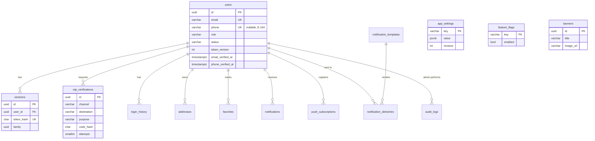
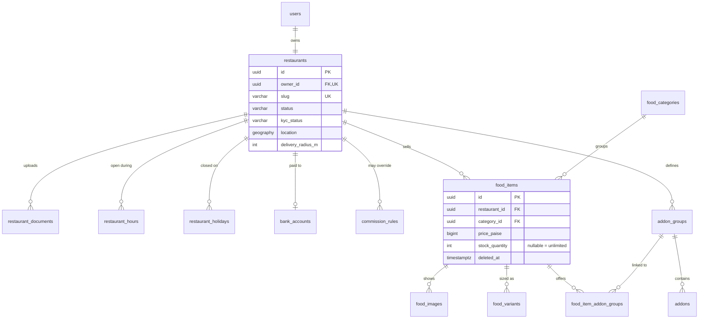
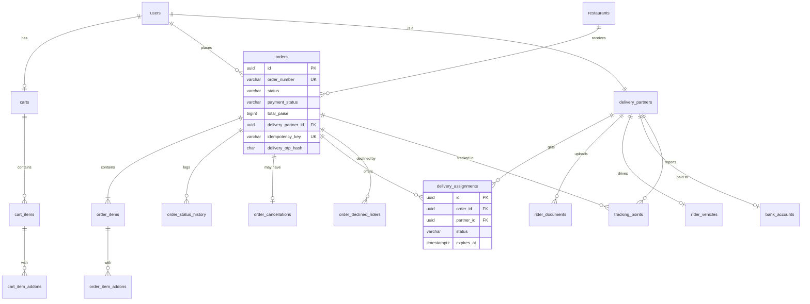
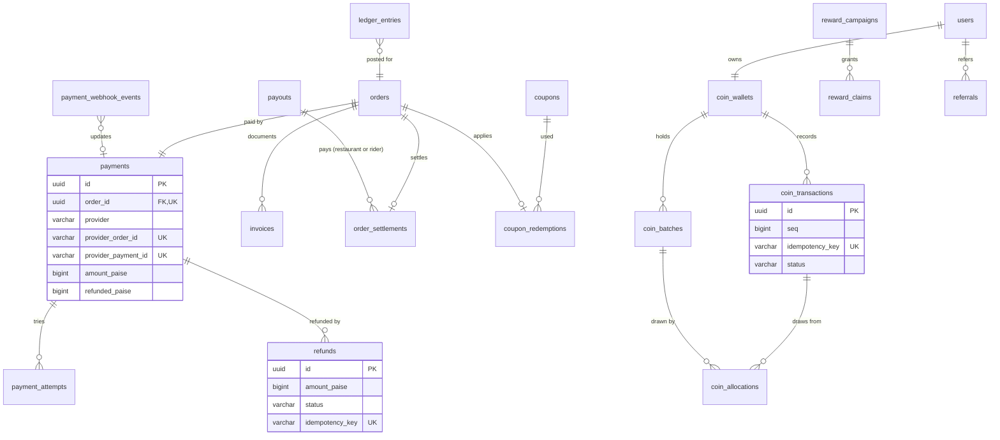
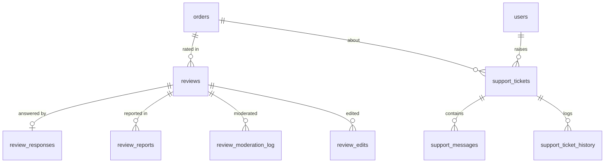

# 3. Data model (PostgreSQL)

Phase 1 deliverables D (ER diagram) and E (table specifications and the MongoDB → PostgreSQL mapping).

## 3.1 Conventions

| Rule | Detail |
|---|---|
| Primary keys | `id uuid` (UUIDv7 generated in Python, so ids sort roughly by time and index well). Every table imported from MongoDB gets `legacy_id char(24) UNIQUE NULL`. |
| Timestamps | `created_at`, `updated_at timestamptz` (UTC, `USE_TZ=True`) on every mutable table. Append-only tables have `created_at` only. |
| Money | `bigint` paise, column suffix `_paise`, `CHECK (x >= 0)` unless a signed adjustment. **Pending approval (Q5).** If `DecimalField` is chosen: `numeric(12,2)` rupees with the same names minus the suffix. |
| Enums | `varchar` + `CHECK (col IN (...))` generated from Django `TextChoices`. Values identical to today's strings. |
| Geo | `geography(Point, 4326)` with a GiST index (PostGIS) |
| Soft delete | Only `restaurants` (none today; added for safety) and `food_items` (`deleted_at`). All other deletes are real or forbidden. |
| Deletion policy | `on_delete=PROTECT` for anything referenced by orders, payments or ledgers. `CASCADE` only for owned children (cart items, add-on links). |
| JSON | `jsonb` only for immutable snapshots and open-ended metadata (order snapshots, audit metadata, webhook payloads). Queryable fields are always real columns. |
| Names | Django app label + model, e.g. `orders_order`. Logical names are used in this document. |
| Users | A custom `accounts.User` (`AUTH_USER_MODEL`) set in the **first** migration |

## 3.2 ER diagram

Split into domains for readability. `users` appears in several diagrams.

### Identity, customers and system

### Restaurants and menus

### Cart, orders and delivery

### Payments, finance, promotions, coins

### Reviews and support

## 3.3 Table specifications

Column types are PostgreSQL. `NN` = NOT NULL, `UK` = unique, `FK` = foreign key, `IX` = index. Each table also has the `id`, `created_at`, `updated_at` and `legacy_id` columns from §3.1 unless noted.

### accounts / rbac

**users**
| Column | Type | Constraints |
|---|---|---|
| name | varchar(80) | NN, 2 to 80 characters |
| email | varchar(254) | UK on `lower(email)`, NN |
| phone | varchar(16) | UK partial (`WHERE phone IS NOT NULL`), E.164 check |
| password | varchar(128) | Django hasher format (Argon2id; bcrypt accepted and re-hashed on login) |
| role | varchar(24) | NN, CHECK in 7 roles |
| status | varchar(16) | NN, `active`, `suspended`; default `active` |
| token_version | int | NN, default 0 |
| email_verified_at, phone_verified_at, last_login_at | timestamptz | nullable |
| referral_code | varchar(40) | UK partial |
| birth_date | date | nullable |
| push_orders, push_account, push_promotions | bool | defaults true, true, false |
| sms_enabled, email_marketing | bool | new; defaults true, false |

Indexes: `(role, status, created_at DESC)`.

**Roles and permissions.** These stay code-defined (`rbac/permissions.py`) and are not stored in tables. The set is small, versioned with code and checked on every request, and a table would add a query and an admin screen without adding flexibility. This deviates from the master prompt's `roles`/`user_roles`/`role_permissions` tables, as an explicit decision. New permissions: `kyc:review`, `settings:manage`, `disputes:manage`, `incentives:manage`. If configurable custom roles are needed later, add the tables then.

**sessions**: `user_id` FK NN IX, `token_hash` char(64) UK, `family` uuid IX, `expires_at` timestamptz NN IX, `revoked_at` timestamptz, `revoked_reason` varchar(20) CHECK (rotated, logout, reuse, password-change, suspended, role-change), `user_agent` varchar(512), `ip` inet. A Beat task deletes expired rows daily (this replaces the MongoDB TTL index).

**otp_verifications** (new): `channel` (sms, email), `destination` varchar(254) NN, `purpose` (login, register, verify_phone, verify_email), `code_hash` char(64), `attempts` smallint default 0, `max_attempts` smallint default 5, `expires_at` NN, `consumed_at`, `ip` inet. IX `(destination, purpose, created_at DESC)`. Resend cooldown 30 s; at most 5 sends per destination per hour (Redis counter).

**login_history** (new, append-only): `user_id` FK IX, `method` (password, otp, refresh), `success` bool, `failure_reason`, `ip` inet, `user_agent`, `created_at`. Kept for 180 days.

### customers

**addresses**: `user_id` FK NN, `label` (home, work, other), `recipient_name` varchar(80), `phone`, `area` varchar(80), `landmark` varchar(80), `city` varchar(60) NN, `state` varchar(60) NN, `postal_code` varchar(10) NN, `location` geography NN, `is_default` bool. Partial unique index `(user_id) WHERE is_default`. The limit of 10 per user is enforced in the service.

**favorites** (new): `user_id` FK, `restaurant_id` FK NULL, `food_item_id` FK NULL. CHECK that exactly one target is set. UK `(user_id, restaurant_id)` and `(user_id, food_item_id)` as partial indexes.

### restaurants

**restaurants**
| Column | Type | Notes |
|---|---|---|
| owner_id | uuid FK users | UK |
| name | varchar(100) | NN |
| slug | varchar(120) | UK |
| description | varchar(1000) | |
| cuisines | varchar(40)[] | 1 to 10 items. GIN index. |
| phone, email | varchar | |
| address_line, area, city, state, postal_code | varchar | flattened from the embedded address |
| location | geography(Point) | NN, GiST |
| image_url, cover_url, logo_url | varchar(500) | cover and logo are new |
| is_pure_veg | bool | |
| cost_for_two_paise, min_order_paise | bigint | CHECK ≥ 0 |
| avg_prep_time_minutes | smallint | 5 to 180 |
| delivery_radius_m | int | new; default 15000, CHECK ≤ platform maximum (enforced in the service) |
| timezone | varchar(60) | default `Asia/Kolkata` |
| is_accepting_orders | bool | |
| status | varchar(24) | pending, approved, rejected, needs_resubmission (new), suspended |
| status_reason, reviewed_at, reviewed_by_id | | |
| gstin | varchar(15) | nullable. Format checked. |
| fssai_number | varchar(14) | 14 digits; required to submit |
| fssai_expires_on | date | |
| legal_name | varchar(150) | |
| rating_average numeric(3,2), rating_count int, rating_distribution int[5] | | replaces the embedded `RatingSummary` |
| deleted_at | timestamptz | |

Indexes: `(status, rating_average DESC)`, `(status, created_at DESC)`, GIN `cuisines`, trigram GIN on `name` (`pg_trgm`) for search.

**restaurant_hours** (new): `restaurant_id` FK, `weekday` smallint 0 to 6, `opens_at` time, `closes_at` time (`closes_at < opens_at` means the slot ends after midnight). UK `(restaurant_id, weekday, opens_at)`. Migrated rows: 7 copies of the old opening and closing times.

**restaurant_holidays** (new): `restaurant_id`, `date`, `reason`. UK `(restaurant_id, date)`.

**restaurant_documents** and **rider_documents** (new, same shape): owner FK, `doc_type` (fssai_licence, gst_certificate, pan, cancelled_cheque, shop_photo / driving_licence, vehicle_rc, id_proof, profile_photo, insurance), `file_key` varchar(300) (private bucket key, never a public URL), `mime_type`, `size_bytes`, `number_encrypted` bytea (document number, encrypted with Fernet via `django-cryptography` or an app-level helper), `number_last4` varchar(4), `expires_on` date, `status` (pending, accepted, rejected, expired), `review_note`, `reviewed_by_id`, `reviewed_at`. IX `(status, created_at)`.

**bank_accounts** (new, shared by restaurants and riders): `owner_user_id` FK UK, `holder_name`, `account_number_encrypted` bytea, `account_last4`, `ifsc` varchar(11), `bank_name`, `verified_at`, `verified_by_id`.

### menus

**food_categories**: `name` varchar(50), `slug` UK, `description`, `icon` varchar(40), `image_url`, `sort_order` int, `is_active` bool. IX `(is_active, sort_order, name)`.

**food_items**: `restaurant_id` FK NN, `category_id` FK PROTECT, `name` varchar(100), `description` varchar(500), `price_paise` bigint CHECK 100 to 10,000,000, `is_veg` bool NN, `is_available` bool, `image_url` (primary image, kept for compatibility), `prep_time_minutes` smallint, `tags` varchar(30)[] ≤ 10, `stock_quantity` int NULL (new; NULL = unlimited), `rating_*` columns, `deleted_at`. Indexes: `(restaurant_id, deleted_at, category_id)`, `(category_id, deleted_at, is_available)`, trigram on `name`.

**food_images** (new): `food_item_id` FK CASCADE, `url`, `sort_order`.

**food_variants** (new): `food_item_id` FK CASCADE, `name` varchar(60) (e.g. "Half", "Full"), `price_paise` bigint (replaces the item price when chosen), `is_default` bool, `is_available` bool, `sort_order`. UK `(food_item_id, name)`. Partial UK: one default per item. When an item has variants, a variant must be chosen.

**addon_groups** (new): `restaurant_id` FK, `name` varchar(60), `min_select` smallint, `max_select` smallint, CHECK `0 ≤ min ≤ max ≤ 20`.

**addons** (new): `group_id` FK CASCADE, `name` varchar(60), `price_paise` bigint ≥ 0, `is_veg` bool, `is_available` bool, `sort_order`.

**food_item_addon_groups** (new, link table): `food_item_id`, `group_id`, `sort_order`. UK pair.

### cart

**carts**: `user_id` FK UK, `restaurant_id` FK NULL, `coupon_code` varchar(30), `coins_to_redeem` int ≥ 0.

**cart_items**: `cart_id` FK CASCADE, `food_item_id` FK, `variant_id` FK NULL, `quantity` smallint 1 to max, `instructions` varchar(200) (new), `line_key` char(64) (hash of item + variant + sorted add-ons, so identical lines merge). UK `(cart_id, line_key)`. Line limit enforced in the service.

**cart_item_addons**: `cart_item_id` FK CASCADE, `addon_id` FK. UK pair.

API compatibility: today's `/cart/items/{foodItemId}` path addresses a line by dish. In Django it becomes the **cart line id**. A dish id is still accepted when the dish has exactly one line. See the API delta.

### orders

**orders**
| Column | Type | Notes |
|---|---|---|
| order_number | varchar(20) | UK. Same format as today. |
| customer_id | FK users PROTECT | IX `(customer_id, created_at DESC)` |
| restaurant_id | FK restaurants PROTECT | |
| restaurant_snapshot | jsonb | name, slug, phone, address, location |
| delivery_address | jsonb | label, recipientName, phone, area, landmark, city, state, postalCode |
| delivery_location | geography(Point) | NN (a column, because tracking and dispatch query it) |
| subtotal_paise, discount_paise, coin_discount_paise, delivery_fee_paise, platform_fee_paise, tax_paise, total_paise | bigint | CHECK ≥ 0. CHECK total = subtotal − discount − coin discount + fees + tax. |
| pricing_version | int | `app_settings` revision used for this order |
| coupon_code, coupon_discount_paise | | |
| coins_redeemed, coins_discount_paise, coins_state, coins_earned | | state: reserved, committed, released, refunded |
| distance_m | int | straight-line |
| note | varchar(300) | |
| status | varchar(24) | CHECK in the statuses (§2.3) |
| payment_method | varchar(10) | cod, online |
| payment_status | varchar(20) | pending, paid, failed, refunded, partially_refunded, cancelled |
| submitted_at | timestamptz | NULL until paid (online) |
| delivery_partner_id | FK users NULL | |
| delivery_otp_hash | char(64) | |
| delivery_otp_attempts | smallint | |
| idempotency_key | varchar(100) | partial UK `(customer_id, idempotency_key)` |
| status_changed_at | timestamptz | used by the sweeps |

Indexes (from today's MongoDB indexes): `(restaurant_id, status, created_at DESC) WHERE submitted_at IS NOT NULL`, `(status, created_at DESC)`, `(delivery_partner_id, status, created_at DESC)`, `(status, status_changed_at)` for the sweeps.

**order_items**: `order_id` FK CASCADE, `food_item_id` FK PROTECT, `name`, `variant_name`, `is_veg`, `unit_price_paise` (variant price if any), `addons_price_paise`, `quantity`, `line_total_paise`, `instructions`.

**order_item_addons**: `order_item_id` FK, `addon_id` FK NULL (SET NULL), `group_name`, `name`, `price_paise`. These are snapshots.

**order_status_history** (append-only): `order_id` FK IX, `from_status`, `to_status`, `actor_role`, `actor_id` FK NULL, `note`, `created_at`.

**order_cancellations**: `order_id` UK, `by` (customer, restaurant, admin, system), `reason_code` (customer_request, restaurant_rejected, payment_timeout, no_rider, delivery_failed, admin_other, …), `reason` text.

### delivery

**delivery_partners**: `user_id` FK UK, `is_online`, `location` geography NULL GiST, `location_updated_at`, `location_accuracy_m` real, `current_offer_id` FK orders NULL, `active_order_id` FK orders NULL, `last_assigned_at`, `completed_deliveries` int, `kyc_status` (draft, pending, approved, rejected, needs_resubmission, suspended), rating columns. Partial index for dispatch: `(is_online) WHERE active_order_id IS NULL AND current_offer_id IS NULL AND kyc_status = 'approved'` plus GiST on `location`.

**rider_vehicles**: `partner_id` UK, `vehicle_type` (bicycle, scooter, motorbike, car), `vehicle_number` varchar(20). Migrated from the two DeliveryPartner fields.

**delivery_assignments** (new; replaces `order.offer` + `declinedBy`): `order_id`, `partner_id`, `status` (offered, accepted, declined, expired, cancelled, completed), `offered_at`, `expires_at`, `responded_at`, `estimated_earnings_paise`, `distance_to_pickup_m`, `assigned_by_id` (admin, for manual assignment). Partial UK `(order_id) WHERE status IN ('offered','accepted')`, so an order can have only one live assignment. The "declined riders" set is derived from rows with status `declined`/`expired`.

**tracking_points** (new): `partner_id`, `order_id` NULL, `location`, `accuracy_m`, `speed_mps`, `recorded_at`. Sampled every 15 s at most. BRIN index on `recorded_at`. Deleted after 30 days by a Beat task. Partition by month later if volume needs it.

### payments

**payments**: `order_id` UK, `user_id`, `method`, `provider` (cash_on_delivery, razorpay, mock), `amount_paise`, `refunded_paise` default 0, CHECK `refunded ≤ amount`, `currency` char(3), `status`, `provider_order_id` partial UK `(provider, provider_order_id)`, `provider_payment_id` partial UK, `failure_reason`, `paid_at`, `refunded_at`.

**payment_attempts** (new): `payment_id`, `provider_order_id`, `status` (created, succeeded, failed, abandoned), `error_code`, `error_description`, `created_at`.

**payment_webhook_events** (new; replaces `processedEvents[]`): `provider`, `event_id` UK `(provider, event_id)`, `event_type`, `payload` jsonb, `signature_valid` bool, `processed_at`, `error`. Rows with invalid signatures are kept for 7 days for forensics.

**refunds** (new): `payment_id`, `order_id`, `amount_paise` > 0, `reason_code`, `reason`, `status` (pending, processing, processed, failed, manual_pending, manual_done), `provider_refund_id` partial UK, `idempotency_key` UK, `requested_by_id`, `failure_reason`, `processed_at`.

**invoices** (new): `kind` (customer_tax_invoice, restaurant_commission_invoice), `number` UK (series per financial year), `order_id` NULL, `restaurant_id` NULL, `period_from`, `period_to`, `amount_paise`, `tax_paise`, `file_key` (private bucket), `issued_at`.

### finance

**commission_rules** (new): `restaurant_id` NULL (NULL = global), `basis_points` int 0 to 10000, `effective_from` timestamptz, `effective_to` NULL, `created_by_id`. A partial UK on `(restaurant_id) WHERE effective_to IS NULL` keeps one active rule per scope.

**order_settlements** (replaces `order.settlement` + `order.payouts`): `order_id` UK, `restaurant_paise`, `rider_paise`, `platform_paise`, `commission_bp`, `refund_adjustment_paise` (signed), `settled_at`, `restaurant_payout_id` FK NULL, `rider_payout_id` FK NULL. IX `(restaurant_payout_id)`, `(rider_payout_id)`, `(settled_at)`.

**payouts**: `type` (restaurant, rider), `restaurant_id` NULL, `payee_id` FK users, `payee_name`, `orders_count`, `amount_paise`, `incentive_paise` (new), `period_from`, `period_to`, `status` (pending, paid, cancelled), `reference` varchar(120), `note`, `created_by_id`, `paid_by_id`, `paid_at`. IX `(type, status, created_at DESC)`, `(payee_id, created_at DESC)`.

**ledger_entries** (new, append-only, double entry): `entry_group` uuid (one financial event), `account` (customer_payments, restaurant_payable, rider_payable, platform_revenue, tax_payable, refunds, cash_in_hand), `order_id` NULL, `payout_id` NULL, `amount_paise` (signed), `description`, `created_at`. A CHECK in the service makes each group sum to 0. DB triggers reject UPDATE and DELETE (the same "immutable" rule as the coin ledger). This is the source for reconciliation reports. `order_settlements` stays as the fast per-order view.

**incentive_rules** (release 3): `name`, `period` (day, week), `min_deliveries`, `bonus_paise`, `valid_from`, `valid_to`, `is_active`.

### promotions

**coupons**: same fields as today. `code` UK upper, `discount_type` (percent, flat), `discount_value` int ≥ 1, `max_discount_paise` NULL, `min_order_paise`, `valid_from`, `valid_until`, `is_active`, `usage_limit` NULL, `used_count` (updated with `select_for_update`), `per_user_limit`, `restaurant_id` NULL. IX `(is_active, valid_until)`.

**coupon_redemptions**: `coupon_id`, `user_id`, `order_id` UK, `discount_paise`. IX `(coupon_id, user_id)`.

**banners** (new): `title`, `subtitle`, `image_url`, `link` (internal route or restaurant slug), `sort_order`, `starts_at`, `ends_at`, `is_active`, `audience` (all, new_customers).

### coins and rewards

The MongoDB design embeds batches and allocations in arrays. Here they are normalised.

**coin_wallets**: `user_id` UK, `available`, `reserved`, `total_earned`, `total_redeemed`, `total_expired`, `total_reversed`, `uncollected_reversal`, `seq` (all bigint ≥ 0). Always updated with `select_for_update`.

**coin_batches**: `wallet_id`, `origin_txn_id`, `source`, `original` > 0, `remaining` ≥ 0, `earned_at`, `expires_at` NULL. IX `(wallet_id, expires_at, earned_at)` for FIFO spending, `(expires_at) WHERE remaining > 0`.

**coin_transactions** (immutable): `user_id`, `wallet_id`, `seq`, `type`, `source`, `reversal_of`, `requested_coins`, `shortfall`, `available_before/after`, `reserved_before/after`, `expires_at`, `order_id`, `campaign_id`, `referral_id`, `related_txn_id`, `idempotency_key` UK, `description`, `note`, `created_by_id`, `status` (pending, posted), `posted_at`. UK `(wallet_id, seq)`. A trigger allows only the `pending → posted` update and rejects deletes.

**coin_allocations**: `transaction_id`, `batch_id`, `coins` > 0.

**reward_campaigns**, **reward_campaign_restaurants** (link), **reward_claims** (`claim_key` UK), **reward_configuration** (single row, typed columns or a validated `jsonb` with `revision`), **referrals** (`referred_id` UK), **referral_reward_counters** (UK `(referrer_id, period)`). Same fields as today, flattened. `risk_flags varchar[]`, and `referral_history` as a child table.

### reviews

**reviews**: `target` (restaurant, food, rider), `customer_id`, `customer_name`, `order_id`, `order_number`, `restaurant_id`, `food_item_id` NULL, `food_name`, `delivery_partner_id` NULL, `rating` smallint 1 to 5, `comment` text, `images` varchar(500)[] (at most the policy maximum), `status` (published, hidden, removed, deleted), `edited_at`, `deleted_at`, `open_reports` int, `moderation_action`, `moderation_reason`, `moderated_at`. UK `(order_id, target, coalesce(food_item_id, '0…'))`. Indexes as in MongoDB.

**review_responses**: `review_id` UK, `text`, `responded_at`, `updated_at`. **review_edits**, **review_moderation_log**, **review_reports** (UK `(review_id, reporter_id)`).

### support

**support_tickets**: `number` UK, `raised_by_id`, `requester_role`, `requester_name`, `type` (order_issue, delivery, payment, refund, account, other, **dispute** (new)), `subject`, `order_id` NULL, `order_number`, `priority`, `status`, `assignee_id` NULL, `last_activity_at`, `resolved_at`, `closed_at`. Indexes as in MongoDB.

**support_messages**: `ticket_id`, `author_id`, `author_role`, `author_name`, `body` varchar(2000), `internal` bool, `attachments` varchar[] (new), `created_at`. Requester queries always filter `internal = false` in the selector.

**support_ticket_history**: `ticket_id`, `action`, `from_value`, `to_value`, `note`, `by_id`, `by_name`, `created_at`.

### notifications

**notifications**: `user_id`, `type` varchar(40), `title`, `body`, `link`, `order_id` NULL, `read_at`, `created_at`. IX `(user_id, created_at DESC)`, `(user_id) WHERE read_at IS NULL`. Daily Beat purge after 90 days.

**notification_templates** (new): `key` (e.g. `order.delivered`), `channel` (email, sms, push, inapp), `locale`, `subject`, `body` (Django template syntax, sandboxed), `dlt_template_id` (SMS, India), `is_active`. UK `(key, channel, locale)`.

**notification_deliveries** (new): `notification_id` NULL, `user_id`, `channel`, `template_key`, `destination_masked`, `status` (queued, sent, failed, skipped_preference, skipped_unconfigured), `provider_message_id`, `attempts`, `last_error`, `sent_at`.

**push_subscriptions**: `user_id`, `endpoint` UK (varchar 1000), `p256dh`, `auth`, `expiration_time`, `device`, `last_success_at`, `failures`.

**device_tokens** (release 3, FCM): `user_id`, `platform` (android, ios, web), `token` UK, `last_seen_at`.

### system

**audit_logs** (append-only): `admin_id`, `admin_role`, `action` varchar(60), `description` varchar(500), `resource_type`, `resource_id` varchar(64), `metadata` jsonb, `ip` inet, `created_at`. Indexes: `(created_at DESC)`, `(admin_id, created_at DESC)`, `(action, created_at DESC)`, `(resource_id, created_at DESC)`.

**app_settings**: `key` varchar(80) PK (e.g. `pricing`, `dispatch`, `earnings`, `delivery`), `value` jsonb validated by a serializer per key, `revision` int, `updated_by_id`, `updated_at`. **app_settings_history** keeps every revision (orders reference `pricing_version`).

**feature_flags**: `key` PK, `enabled`, `description`, `rollout_percent` smallint NULL.

**newsletter_subscriptions**: `email` UK (lower), `status`, `source`, `subscribed_at`.

## 3.4 MongoDB → PostgreSQL mapping

| MongoDB model (file) | PostgreSQL tables | Transformations |
|---|---|---|
| User (`user.model.js`) | users | `_id` → new UUID + `legacy_id`. `passwordHash` → `password` as `bcrypt$<hash>` (Django's `BCryptPasswordHasher` format, re-hashed to Argon2 on next login). `pushPreferences.*` → three columns. `passwordResetTokenHash/ExpiresAt` are dropped (reset links in flight expire). |
| Session (`session.model.js`) | sessions | Copied, or **dropped** with every user signed out at switch-over (recommended: simpler and safe) |
| Restaurant (`restaurant.model.js`) | restaurants, restaurant_hours | Embedded `address` flattened. `location.coordinates [lng, lat]` → `ST_Point(lng, lat)`. `openingTime/closingTime` → 7 `restaurant_hours` rows. `rating` → `rating_*` columns. `kyc_status = 'draft'` for existing restaurants; approved ones keep trading during a grace period (setting `kyc.graceDays`). |
| FoodCategory | food_categories | direct |
| FoodItem | food_items | `rating` flattened. No variants or add-ons yet. |
| Address | addresses | `location` → geography |
| Cart | carts, cart_items | `items[]` → rows (`line_key` computed). Optionally carts are **dropped** at switch-over (short-lived data). |
| Coupon, CouponRedemption | coupons, coupon_redemptions | direct. `used_count` re-checked against the redemption count. |
| Order (`order.model.js`) | orders, order_items, order_status_history, order_cancellations, order_settlements, delivery_assignments | `restaurantSnapshot`, `deliveryAddress` → jsonb + `delivery_location`. `pricing.*` → columns. `coins.*` → columns. `items[]` → order_items. `statusHistory[]` → history rows (`from_status` derived from the previous entry). `cancellation` → order_cancellations. `settlement` + `payouts.*` → order_settlements. `offer` (if live) → one `offered` assignment; `declinedBy[]` → `declined` assignments. `pricing_version = 0` ("legacy"). |
| Payment (in `order.model.js`) | payments, payment_webhook_events, refunds | `processedEvents[]` → webhook event rows (no payload). `providerRefundId`/`refundedAt` → one `processed` refund for the full amount, `refunded_paise = amount_paise`. |
| DeliveryPartner | delivery_partners, rider_vehicles | `vehicleType/Number` → rider_vehicles. `currentOffer`/`activeOrder` mapped through the order id map. `kyc_status = 'draft'` plus a grace period. |
| Payout | payouts | direct |
| Notification | notifications | Rows older than 90 days skipped |
| PushSubscription | push_subscriptions | `keys.p256dh/auth` → columns |
| Review, ReviewReport | reviews, review_responses, review_edits, review_moderation_log, review_reports | Embedded `response`, `edits[]`, `moderationLog[]` → child tables |
| SupportTicket | support_tickets, support_messages, support_ticket_history | Embedded `messages[]`, `history[]` → child rows |
| AuditLog | audit_logs | direct |
| CoinWallet | coin_wallets, coin_batches | `batches[]` → rows (batch `_id` → UUID map, needed by allocations) |
| CoinTransaction | coin_transactions, coin_allocations | `allocations[]` → rows. **Imported with triggers temporarily disabled inside the import transaction only.** |
| Referral, ReferralRewardCounter | referrals, referral_history, referral_reward_counters | `history[]` → rows. `signupIp` → inet. |
| RewardCampaign, RewardClaim | reward_campaigns, reward_campaign_restaurants, reward_claims | `conditions.restaurants[]` → link rows. `limits`, `stats` → columns. |
| RewardConfiguration | reward_configuration | single row |
| NewsletterSubscription | newsletter_subscriptions | direct |
| RatingSummary (embedded schema) | `rating_average`, `rating_count`, `rating_distribution` columns | on restaurants, food_items, delivery_partners |

**Import procedure (`manage.py import_mongo --uri … --dry-run`):**
1. Read collections in dependency order (users → restaurants → categories → foods → addresses → orders → payments → …), building `legacy_id → uuid` maps in a temporary table.
2. Run one transaction per collection, in batches of 1,000.
3. Verify and report: row counts per collection vs. table; sums of `total_paise`, `amount_paise` and coin `available` per wallet; spot-checked orders that are byte-equal after a JSON round trip through the API serializers.
4. Re-running is idempotent (upsert on `legacy_id`).
5. Never point it at the developer's real database without an explicit `--target` that is not the default settings database. Rehearse on a copy.

## 3.5 Phase 4 implementation notes (what changed from the plan above)

Built: the **parity schema**, 45 tables in 17 apps under `backend-django/apps/` with migrations, constraints, indexes, a seed command and tests. Tables for new features (KYC documents, bank accounts, variants and add-ons, OTP, favourites, banners, invoices, ledger entries, commission rules, tracking points, app settings, login history) come with the phases that build those features.

| Planned | Built | Why |
|---|---|---|
| GeoDjango `PointField` (GDAL/GEOS) | `common.geo.PointField`, still a PostGIS `geography(Point,4326)` column on PostgreSQL | GeoDjango needs the GDAL and GEOS C libraries just to import, and they aren't on the development machine. The database still does all geometry (ST_DWithin, ST_Distance, `<->` with GiST indexes). Spatial queries are written as database functions in Phases 6 and 7. The Docker image no longer needs GDAL. |
| `varchar[]` arrays (cuisines, tags, review images, risk flags) | `JSONField` lists, with GIN `jsonb_path_ops` indexes on PostgreSQL | They work the same on SQLite (local tests), and `@>` containment filters stay indexed |
| `restaurant_hours` replaces opening/closing times | `opening_time`/`closing_time` kept for now | Parity first. Weekly hours, with a data migration, come in release 2. |
| `reward_configuration` with typed columns | One row with `coins_enabled`, `timezone`, `revision` and a `value` JSON in the Node document shape | Validated by a serializer on write (Phase 9). Defaults stay in code, as in Node. |
| Order `coins.discountPaise` and `pricing.coinDiscountPaise` | One column, `coin_discount_paise` | Node stored the same number twice. The API exposes it in both places. |
| `order_cancellations.reason_code` | Free-text `reason` + `by` (parity) | Reason codes arrive with delivery-failure handling (release 1, Phase 12) |
| `payments.status` gains `partially_refunded` | Not yet | Added with partial refunds (Phase 8) |
| User email unique on `lower(email)` | `email` stored lower-case in `save()`, plain `UNIQUE` | Django requires `USERNAME_FIELD` to be plainly unique. The behaviour is the same as Node's lower-casing. |
| `dispatch.delivery_assignments.partner_id` → `delivery_partners` | `rider_id` → `users` | Matches `orders.delivery_partner_id` (a user id, as in Node). The profile is one join away. |

**PostgreSQL-only parts** (`common/migration_ops.py`, skipped on SQLite):
- the `postgis` and `pg_trgm` extensions (`common.0001_extensions`, a dependency of every app with a point column)
- GiST, GIN and trigram indexes (each app's `0002_postgres`)
- the coin-ledger triggers (`coins.0002_postgres`)

Tests run against SQLite locally and against PostGIS in CI.
